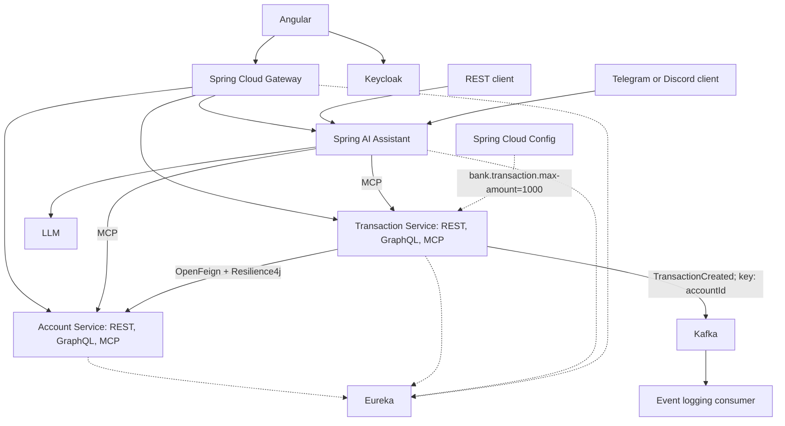

# Architecture

Keycloak handles authentication and authorization. Banking REST, GraphQL and MCP adapters share their service layer. Database and LLM providers are unspecified. Python fraud detection remains a separate experiment. Docker Compose runs the application locally; GitHub Actions supplies CI/CD.

The document specifies transaction validation, balance consultation and update, and transfer support. Transaction direction, overdraft rules and transfer failure semantics remain to be clarified.

